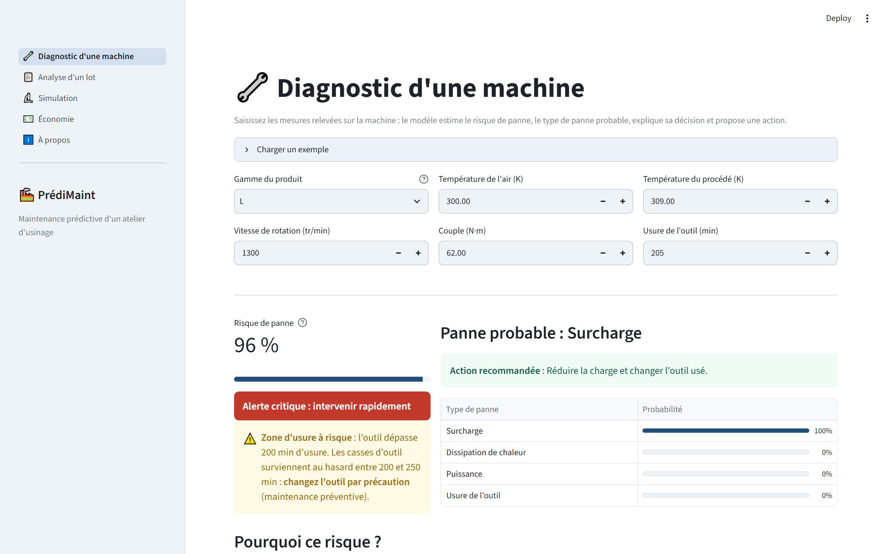
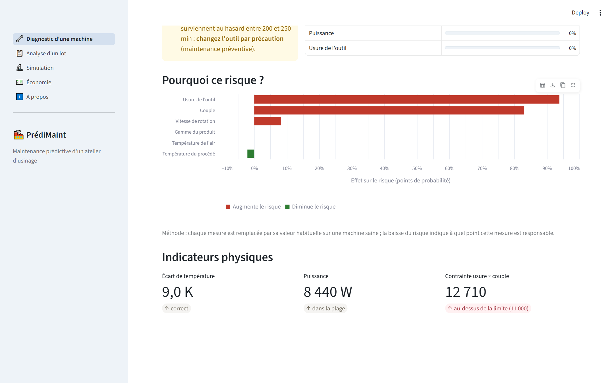
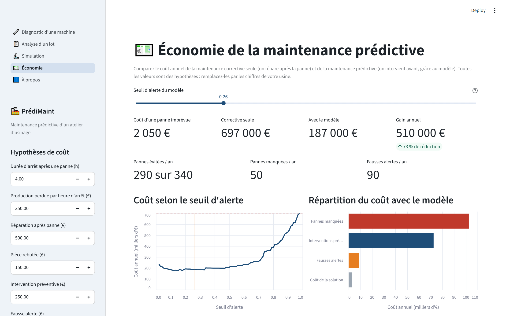
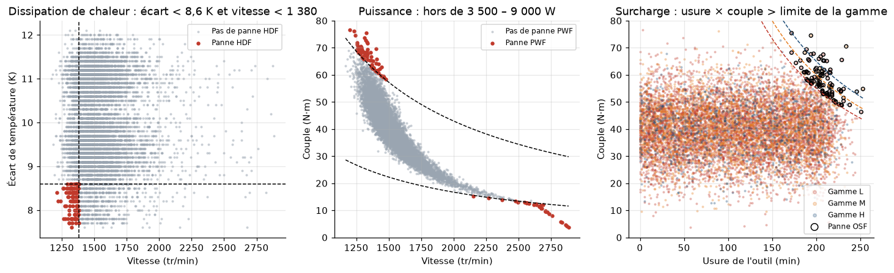

# PrédiMaint — Maintenance prédictive d'un atelier d'usinage

**Prédire la panne d'une machine-outil avant qu'elle n'arrive, l'expliquer, recommander l'action de maintenance et chiffrer le gain pour l'usine.**

🔗 **Application en ligne : [predimaint.streamlit.app](https://predimaint.streamlit.app)** — à essayer directement dans le navigateur, sans installation.



---

## Le problème

Dans un atelier d'usinage, la maintenance prend souvent l'une de ces deux formes :

- **corrective** : on répare après la panne, ce qui arrête la production, abîme la pièce en cours et impose une intervention en urgence ;
- **préventive systématique** : on change les outils à intervalles fixes, et on jette des outils encore utilisables.

Les machines ont pourtant déjà des capteurs. **PrédiMaint** exploite leurs mesures (températures, vitesse de rotation, couple, usure de l'outil) pour **intervenir au bon moment** : c'est la maintenance prédictive.

## Résultats

Résultats sur **2 000 relevés jamais vus** par le modèle :

| Indicateur | Objectif | Résultat |
|---|---|---|
| Pannes détectées (rappel) | ≥ 85 % | **85,3 %** (58 sur 68) |
| Alertes justifiées (précision) | ≥ 70 % | **76,3 %** |
| F1 | ≥ 0,75 | **0,806** |
| Bon type de panne identifié | — | **93,9 %** |
| Gain annuel estimé* | — | **510 000 €, soit −73 %** du coût de maintenance |

\* Avec des hypothèses de coût modifiables dans l'application. Le gain reste positif dès qu'une panne coûte plus d'environ 300 €.

## Ce que fait l'application

| Page | Fonction |
|---|---|
| 🔧 **Diagnostic d'une machine** | Risque de panne, niveau d'alerte, type de panne probable, **explication** de la décision et **action recommandée** |
| 🧰 **Intervention guidée** | La bonne procédure selon la panne prédite : consignation, protections, étapes à cocher, remise en service, compte rendu à télécharger |
| 📡 **Surveillance en continu** | Simulation de capteurs : les relevés arrivent seuls sur 3 machines, alerte dès qu'une machine passe le seuil, journal des alertes comparé aux pannes réelles |
| 📋 **Analyse d'un lot** | Import d'un fichier CSV, classement des machines par risque, export des résultats |
| 🔬 **Simulation** | Évolution du risque quand une mesure varie : jusqu'où peut-on pousser la machine ? |
| 💶 **Économie** | Coût de la maintenance corrective et de la maintenance prédictive ; hypothèses et seuil réglables |
| ℹ️ **À propos** | Données, performances, limites |

<p align="center">
  
  
</p>

## Démarche

1. **[Cahier des charges](docs/CAHIER_DES_CHARGES.md)** : objectifs, besoins (F1 à F17), cibles de performance, planning.
2. **[Exploration des données](notebooks/01_exploration.ipynb)** : 339 pannes sur 10 000 relevés (3,4 %), données très déséquilibrées. Les pannes dépendent de **combinaisons** de capteurs, et non d'un capteur isolé.
3. **[Modélisation](docs/RESULTATS_MODELE.md)** :
   - trois algorithmes comparés (régression logistique, forêt aléatoire, gradient boosting), en validation croisée ;
   - **variables issues du métier** : puissance, écart de température, contrainte usure × couple ;
   - seuil d'alerte réglé pour détecter au moins 85 % des pannes ;
   - test final réalisé une seule fois.
4. **[Étude économique](docs/ETUDE_ECONOMIQUE.md)** : comparaison avec la maintenance corrective, choix du seuil, sensibilité aux hypothèses.
5. **[Manuel d'utilisation](docs/APPLICATION.md)** : les 7 pages de l'application, d'où viennent les données, comment l'application décide, et l'**import de vos relevés en CSV** (Excel accepté).
6. **[Guide de démonstration et de test](docs/GUIDE_DEMONSTRATION.md)** : scénarios vérifiés, script de démonstration, questions et réponses.
7. **[Phase 2 : intervention guidée](docs/INTERVENTION_GUIDEE.md)** : 9 fiches de procédures (sécurité, une fiche par type de panne, remise en service). L'application déroule la bonne fiche, sans modèle de langage, et donc sans coût d'utilisation.

## Ce qu'il faut retenir

- **Les variables issues du métier font la différence.** La PR-AUC de la forêt aléatoire passe de 0,76 avec les capteurs seuls à **0,89** avec la puissance, l'écart de température et la contrainte. La régression logistique plafonne à 0,45, car les pannes dépendent de seuils parfois des deux côtés (puissance trop faible **ou** trop forte).
- **Le modèle a retrouvé la physique.** À 1 500 tr/min, il déclenche une alerte sous 22 N·m et au-dessus de 57 N·m de couple, soit exactement les limites de puissance de 3 500 W et 9 000 W.
- **Prédictif et préventif sont combinés.** Les casses d'outil surviennent au hasard entre 200 et 250 minutes d'usure, et seules 2 sur 10 sont détectées. L'application recommande donc de changer l'outil par précaution dès 200 minutes.
- **Le seuil est un compromis métier.** Le seuil de 26 % donne 90 fausses alertes par an, contre 670 avec un seuil de 5 %, pour un coût presque identique. Trop de fausses alertes, et les techniciens n'y croient plus.



## Installation et utilisation

Prérequis : Python 3.12 ou plus récent.

```bash
git clone https://github.com/richeTchibouanga/PrediMaint.git
cd PrediMaint
python -m venv .venv
.venv\Scripts\activate            # Windows   (Linux / macOS : source .venv/bin/activate)
pip install -r requirements.txt
```

| Action | Commande |
|---|---|
| Lancer l'application | `streamlit run app/app.py` |
| Réentraîner le modèle et régénérer le rapport | `python -m src.entrainer` |
| Refaire l'étude économique | `python -m src.economie` |
| Lancer les tests (42 tests) | `pip install -r requirements-dev.txt` puis `python -m pytest tests` |

Des fichiers d'exemple pour tester l'analyse de lot se trouvent dans [`data/exemples/`](data/exemples).

## Organisation du dépôt

```
predimaint/
├── app/app.py              application Streamlit (5 pages)
├── src/
│   ├── donnees.py          chargement, variables dérivées, séparation entraînement / test
│   ├── entrainer.py        comparaison des modèles, seuil, évaluation, rapport
│   ├── explication.py      explication des prédictions, actions de maintenance
│   ├── economie.py         étude économique
│   ├── lot.py              lecture et analyse d'un fichier de relevés
│   ├── procedures.py       fiches de procédures, choix de la fiche, compte rendu d'intervention
│   └── surveillance.py     surveillance en continu simulée
├── models/                 modèle entraîné et métadonnées
├── notebooks/              exploration des données
├── tests/                  tests automatiques (pytest)
├── data/raw/               données AI4I 2020
├── data/exemples/          fichiers de test pour l'analyse de lot
├── data/procedures/        fiches de procédures de maintenance (Markdown)
└── docs/                   cahier des charges, rapports, guides, PDF de chaque étape, figures
```

## Données

**AI4I 2020 Predictive Maintenance Dataset** — S. Matzka (2020), *Explainable Artificial Intelligence for Predictive Maintenance Applications*. UCI Machine Learning Repository, DOI [10.24432/C5HS5C](https://doi.org/10.24432/C5HS5C). Licence [CC BY 4.0](https://creativecommons.org/licenses/by/4.0/).

## Limites

- Les données sont **synthétiques** : certaines pannes y suivent des règles exactes. Les performances sont donc optimistes. Sur une vraie usine, le modèle devrait être réentraîné sur ses propres données.
- Le modèle se trompe parfois près des frontières de panne. Le [guide de démonstration](docs/GUIDE_DEMONSTRATION.md) présente un cas de fausse alerte identifié lors des tests.
- Les pannes aléatoires et la plupart des casses d'outil ne peuvent pas être anticipées par les capteurs.
- Les coûts de l'étude économique sont des hypothèses.

## Outils

Python · pandas · NumPy · scikit-learn · Matplotlib · Altair · Streamlit · pytest

## Auteur

**Jean de Dieu Riche TCHIBOUANGA** — technicien en maintenance industrielle en reconversion vers la data et l'IA.

[Portfolio](https://riche-tchibouanga.vercel.app) · [LinkedIn](https://www.linkedin.com/in/jean-de-dieu-riche-tchibouanga-107539306) · [GitHub](https://github.com/richeTchibouanga)
