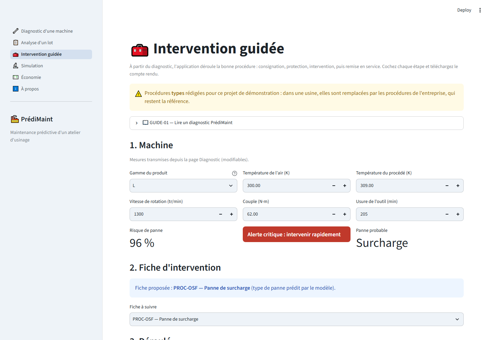
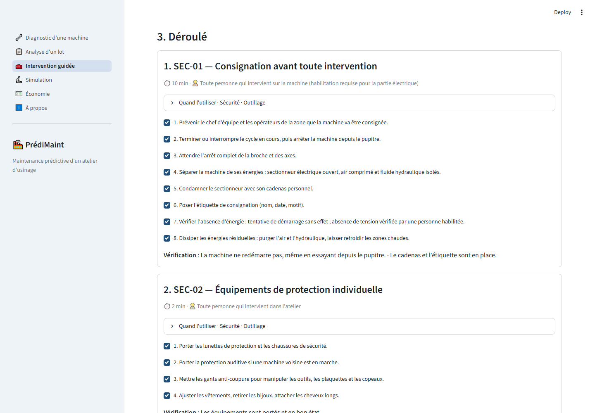
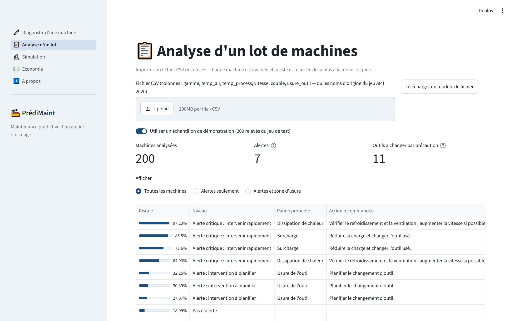
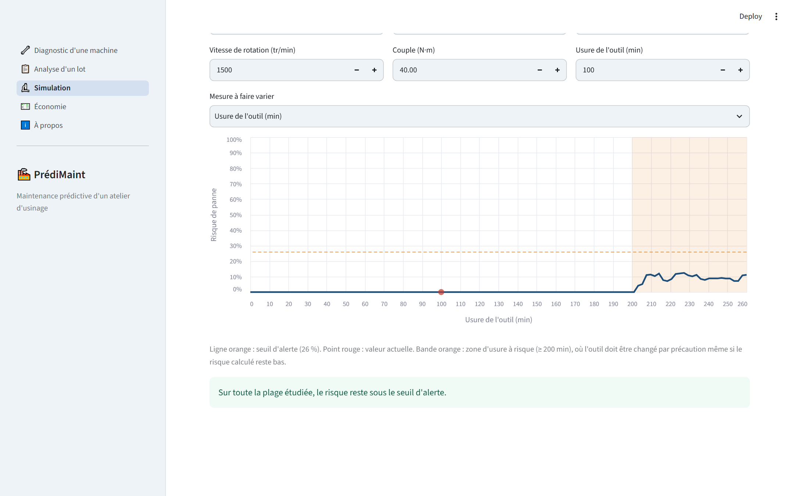
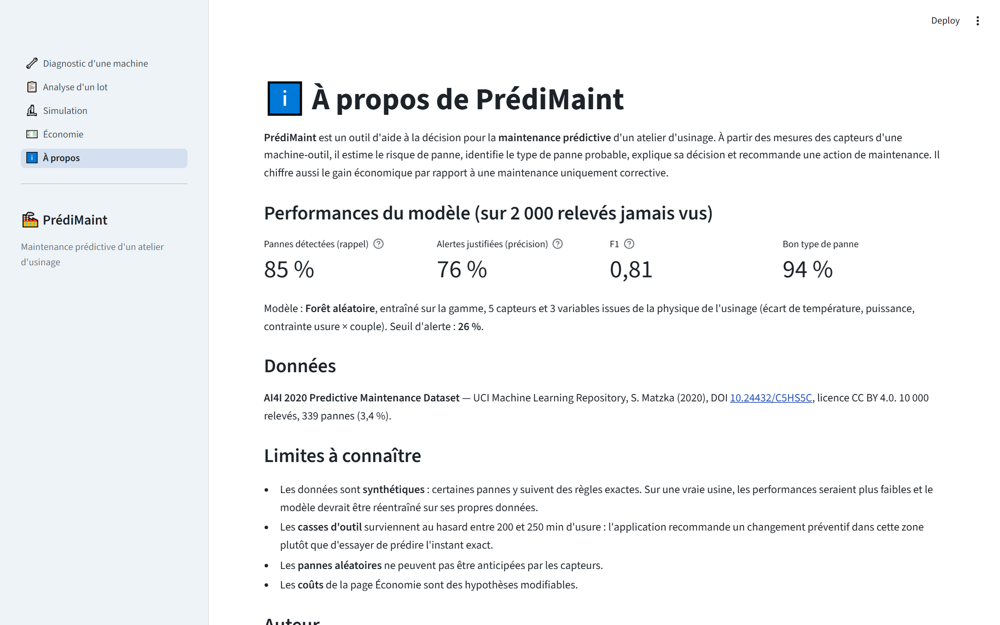

# PrédiMaint — Guide de l'application

*Étape 5 du projet : le tableau de bord de l'atelier d'usinage (livrable L5, fonctions F13 à F17 du cahier des charges).*

## 1. Présentation

L'application rassemble en un seul outil le modèle de prédiction (étape 3) et l'étude économique (étape 4). Elle s'adresse :

- au **technicien de maintenance**, qui veut savoir si une machine est à risque et quoi vérifier ;
- au **responsable de maintenance**, qui veut prioriser les interventions sur tout le parc ;
- au **directeur d'usine**, qui veut connaître le gain de la maintenance prédictive.

Elle compte **6 pages**, accessibles par le menu de gauche.

| Page | Fonction du cahier des charges | À quoi elle sert |
|---|---|---|
| Diagnostic d'une machine | F13 | Risque, type de panne, explication et action pour une machine |
| Intervention guidée | Phase 2 | Dérouler la bonne procédure (consignation, intervention, remise en service) et produire le compte rendu — voir [INTERVENTION_GUIDEE.md](INTERVENTION_GUIDEE.md) |
| Analyse d'un lot | F14 | Classer tout un parc de machines par niveau de risque |
| Simulation | F15 | Voir comment le risque évolue quand une mesure change |
| Économie | F16 (F9 à F12) | Comparer les coûts avec et sans le modèle |
| À propos | F17 | Présentation, données, performances et limites |

## 2. Lancer l'application

Depuis le dossier du projet :

```
.venv\Scripts\streamlit run app/app.py
```

L'application s'ouvre dans le navigateur, à l'adresse `http://localhost:8501`.

## 3. Règles de décision

| Risque calculé | Niveau affiché | Signification |
|---|---|---|
| Moins de 26 % | Pas d'alerte (vert) | Fonctionnement normal, poursuivre la surveillance |
| De 26 % à 60 % | Alerte : intervention à planifier (orange) | Prévoir une intervention dans les prochains jours |
| 60 % et plus | Alerte critique : intervenir rapidement (rouge) | Intervenir avant la prochaine production |

Le seuil de **26 %** est celui retenu à l'étape 3 : il détecte au moins 85 % des pannes, et l'étude économique a confirmé qu'il limite les fausses alertes.

**Règle préventive** : dès que l'usure de l'outil atteint **200 minutes**, l'application recommande de changer l'outil par précaution, même si le risque calculé reste bas. Les casses d'outil surviennent en effet au hasard entre 200 et 250 minutes, et le modèle ne peut pas prédire l'instant exact (voir l'étape 3).

## 4. Diagnostic d'une machine (F13)

On saisit les 6 mesures de la machine : la gamme du produit, les deux températures, la vitesse, le couple et l'usure de l'outil. Quatre exemples sont proposés dans l'encadré « Charger un exemple ».


L'application affiche :

- le **risque de panne** et le **niveau d'alerte** ;
- en cas d'alerte, le **type de panne probable** et l'**action recommandée** ;
- l'avertissement de **zone d'usure** si l'outil dépasse 200 minutes.

Dans l'exemple ci-dessus (gamme L, couple de 62 N·m, outil usé à 205 minutes), le risque est de **96 %** et la panne probable est une **surcharge**. L'action recommandée est de réduire la charge et de changer l'outil.


La partie **« Pourquoi ce risque ? »** explique la décision. Chaque mesure est remplacée, une à une, par sa valeur habituelle sur une machine saine, et on regarde de combien le risque baisse. Ici, l'**usure de l'outil** et le **couple** sont les causes principales.

Les **indicateurs physiques** confirment ce résultat : la contrainte usure × couple (12 710) dépasse la limite de la gamme L (11 000).

En cas d'alerte, ou si l'outil est en zone d'usure, le bouton **« Lancer l'intervention guidée »** ouvre la page suivante avec les mesures de la machine.

## 5. Intervention guidée (phase 2)

Cette page transforme le diagnostic en **procédure à suivre**, à partir de 9 fiches de maintenance rédigées pour le projet (dossier `data/procedures/`).



1. **Machine** : les mesures, transmises depuis le diagnostic ou saisies, ainsi que le risque, le niveau d'alerte et la panne probable.
2. **Fiche d'intervention** : la fiche est proposée automatiquement.

   | Situation | Fiche proposée |
   |---|---|
   | Alerte du modèle | Fiche du type de panne prédit : PROC-OSF, PROC-HDF, PROC-PWF ou PROC-TWF |
   | Pas d'alerte, usure ≥ 200 min | PROC-TWF, changement préventif de l'outil |
   | Pas d'alerte, outil hors de la zone d'usure | Aucune intervention ; une inspection PROC-RNF reste possible |

   Le technicien peut choisir une autre fiche dans la liste.
3. **Déroulé** : toujours **SEC-01 consignation → SEC-02 protections → fiche d'intervention → CTRL-01 remise en service**. Chaque étape se coche, et une barre indique l'avancement. Les étapes d'intervention **ne s'affichent qu'une fois la consignation entièrement validée**.
4. **Compte rendu** : le nom du technicien et les observations, puis le téléchargement d'un compte rendu (date, machine, diagnostic, étapes réalisées ou non, observations).



Les fiches sont des procédures **types** : dans une usine, elles seraient remplacées par celles de l'entreprise. Pour les modifier, il suffit d'éditer les fichiers Markdown, sans programmation. Détails : [INTERVENTION_GUIDEE.md](INTERVENTION_GUIDEE.md).

## 6. Analyse d'un lot (F14)

On importe un fichier CSV contenant un relevé par machine. Les colonnes attendues sont `gamme`, `temp_air`, `temp_process`, `vitesse`, `couple` et `usure_outil` ; les noms d'origine du jeu AI4I 2020 sont aussi acceptés. Un **modèle de fichier** est téléchargeable, et un **échantillon de démonstration** de 200 relevés permet d'essayer sans fichier.



Les machines sont classées de la plus à la moins risquée, avec leur niveau, la panne probable et l'action recommandée. Des filtres permettent d'afficher seulement les alertes, ou les alertes et les outils en zone d'usure. Les résultats se téléchargent en CSV.

Le fichier importé est vérifié. En cas de colonne manquante, de gamme inconnue ou de valeur non numérique, un message clair s'affiche à la place des résultats.

## 7. Simulation (F15)

On part d'une machine, on choisit une mesure, et la courbe montre l'évolution du risque sur toute la plage de cette mesure.



- La **ligne orange en pointillés** représente le seuil d'alerte, et le **point rouge** la valeur actuelle.
- Pour l'usure de l'outil, une **bande orange** marque la zone d'usure à risque, à partir de 200 minutes.
- L'application indique à partir de quelle valeur le seuil d'alerte serait atteint.

## 8. Économie (F16)

Toutes les **hypothèses de coût** se modifient dans le menu de gauche : durée et coût d'un arrêt, réparation, pièce rebutée, intervention préventive, fausse alerte, coût de la solution et volume annuel. Le **seuil d'alerte** se règle avec un curseur.


Les résultats se recalculent instantanément :

- le coût de la maintenance corrective seule et le coût avec le modèle ;
- le gain annuel ;
- les pannes évitées, les pannes manquées et les fausses alertes ;
- la courbe du coût selon le seuil, et la répartition du coût.

Avec les hypothèses par défaut, le gain est de **510 000 € par an**, soit une réduction de 73 %.

## 9. À propos (F17)

Cette page présente le projet, les performances du modèle sur des données jamais vues, la source et la licence des données, les limites, et l'auteur.



## 10. Vérifications réalisées

L'application a été testée automatiquement dans un navigateur :

- chacune des 6 pages s'ouvre ;
- l'exemple « surcharge » s'applique correctement ;
- aucune page n'affiche d'erreur.

| Contrôle | Résultat |
|---|---|
| Diagnostic d'une machine normale | Risque de 0 %, pas d'alerte, aucune mesure en cause |
| Diagnostic de l'exemple « surcharge » | Risque de 96 %, alerte critique, panne de surcharge, action affichée |
| Intervention guidée depuis l'exemple « surcharge » | Fiche PROC-OSF proposée, suite verrouillée avant la consignation, 27 étapes, compte rendu téléchargé |
| Analyse de l'échantillon de démonstration | 200 machines classées, 7 alertes, 11 outils à changer par précaution |
| Simulation de l'usure | Risque faible jusqu'à 200 min, puis remontée dans la zone d'usure |
| Économie aux hypothèses par défaut | 697 000 € sans le modèle, 187 000 € avec, soit 510 000 € de gain (identique à l'étape 4) |
| À propos | Performances conformes au rapport de l'étape 3 |

## 11. Limites

- Les **données sont synthétiques** : sur une vraie usine, il faudrait réentraîner le modèle sur ses propres relevés.
- L'application analyse des **relevés ponctuels**, pas un flux en temps réel venant des machines (évolution possible, voir le § 13 du cahier des charges).
- Les **coûts** de la page Économie sont des hypothèses, à remplacer par les chiffres réels de l'usine.

## 12. Fichiers

| Fichier | Rôle |
|---|---|
| `app/app.py` | L'application Streamlit (6 pages) |
| `.streamlit/config.toml` | Thème aux couleurs du projet (bleu marine) |
| `src/donnees.py`, `src/explication.py`, `src/economie.py` | Code partagé avec les étapes 3 et 4 |
| `models/predimaint.joblib` | Le modèle entraîné |
| `data/procedures/`, `src/procedures.py` | Fiches de procédures et intervention guidée |
