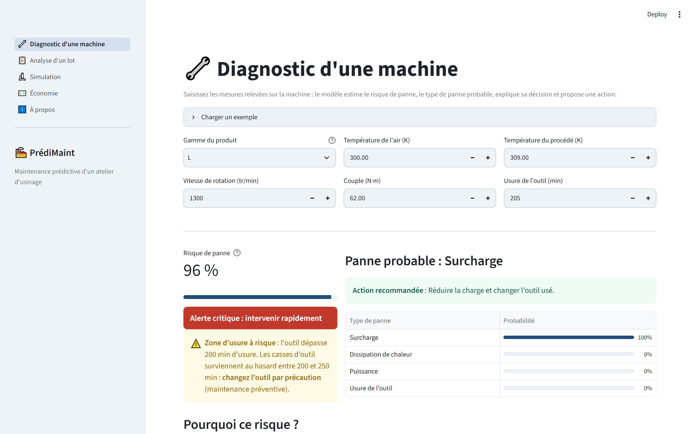
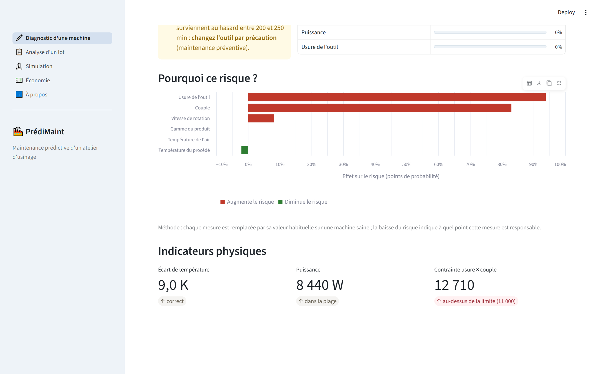
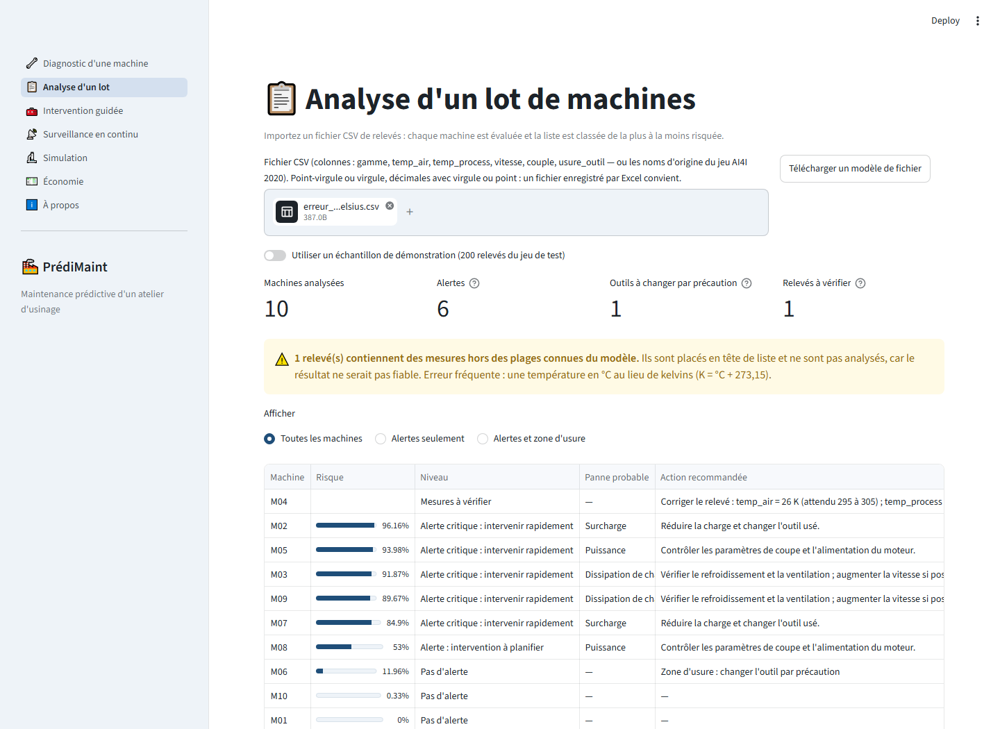
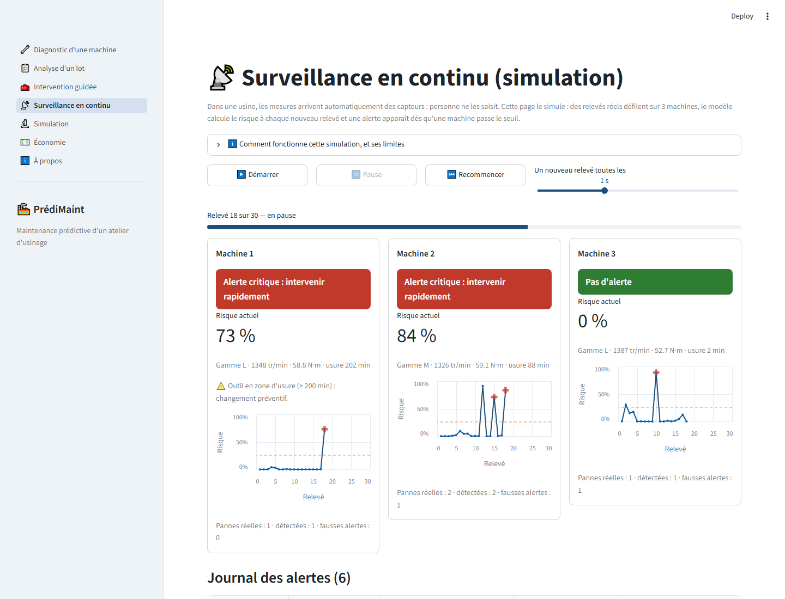
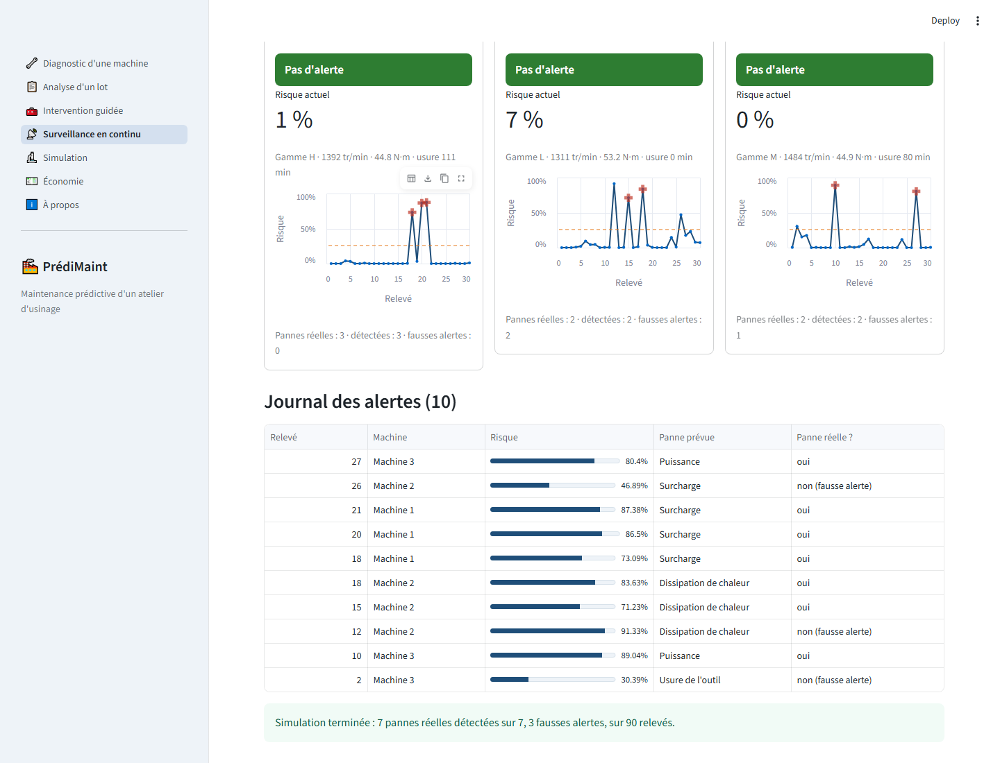
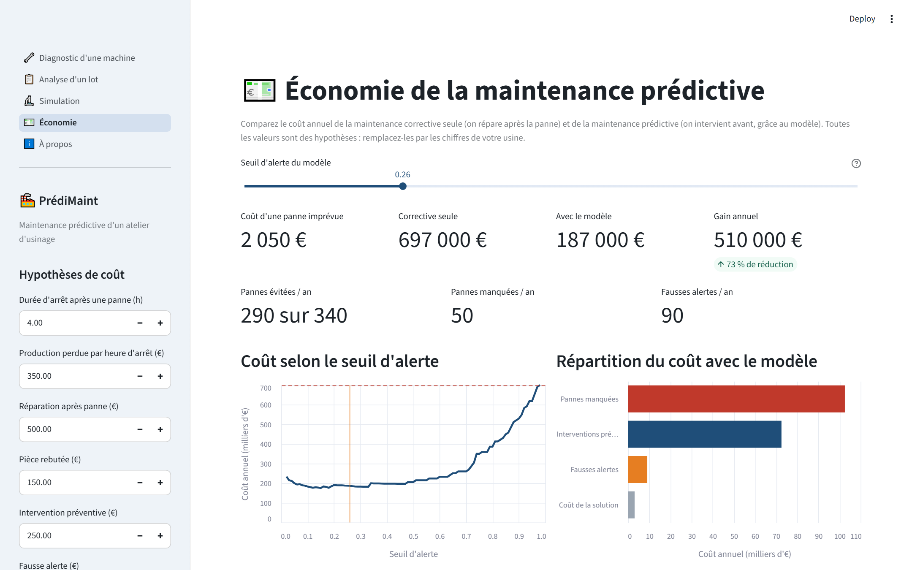

# PrédiMaint — Manuel d'utilisation de l'application

*Le tableau de bord de l'atelier d'usinage : diagnostic, intervention guidée, import de relevés, surveillance, simulation et économie.*

## 1. Présentation

L'application rassemble en un seul outil le modèle de prédiction des pannes, les procédures de maintenance et l'étude économique. Elle s'adresse :

- au **technicien de maintenance**, qui veut savoir si une machine est à risque et comment intervenir ;
- au **responsable de maintenance**, qui veut prioriser les interventions sur tout le parc ;
- au **directeur d'usine**, qui veut connaître le gain de la maintenance prédictive.

Elle compte **7 pages**, accessibles par le menu de gauche.

| Page | À quoi elle sert |
|---|---|
| Diagnostic d'une machine | Risque, type de panne, explication et action, pour une machine |
| Analyse d'un lot | **Importer un fichier de relevés (CSV)** et classer tout le parc par niveau de risque |
| Intervention guidée | Dérouler la bonne procédure (consignation, intervention, remise en service) et produire le compte rendu |
| Surveillance en continu | Voir, en simulation, l'application fonctionner sans saisie, comme branchée sur des capteurs |
| Simulation | Voir comment le risque évolue quand une mesure change |
| Économie | Comparer les coûts avec et sans le modèle |
| À propos | Présentation, données, performances et limites |

## 2. Accéder à l'application

- **En ligne, sans installation** : https://predimaint.streamlit.app
- **Sur son ordinateur** : depuis le dossier du projet, lancer `.venv\Scripts\streamlit run app/app.py`. L'application s'ouvre dans le navigateur à l'adresse `http://localhost:8501`.

## 3. Comment fonctionne l'application

### 3.1 D'où viennent les données ?

**Pour apprendre**, le modèle a été entraîné sur le jeu de données **AI4I 2020** : 10 000 relevés de machines-outils, dont 339 pannes. Pour chaque relevé, on connaît les mesures **et** ce qui s'est passé ensuite (panne ou pas, et de quel type). En comparant les deux, le modèle a appris à reconnaître les situations qui précèdent une panne.

**Pour diagnostiquer**, l'application utilise les mesures qu'on lui fournit, de trois façons :

| Façon | Page | Usage |
|---|---|---|
| Saisie à la main | Diagnostic d'une machine | Contrôler une machine, faire une démonstration |
| **Import d'un fichier CSV** | Analyse d'un lot | Analyser d'un coup les relevés de tout un parc (§ 6) |
| Flux automatique (simulé) | Surveillance en continu | Montrer le fonctionnement « sans saisie » (§ 7) |

**Sans mesures, l'application ne peut rien calculer.** C'est vrai de toute maintenance prédictive : le modèle est le « cerveau », les mesures sont ses « yeux ».

### 3.2 Dans une vraie usine, d'où viendraient les mesures ?

Personne ne les saisirait. Elles viendraient automatiquement des machines :

| Mesure | Source dans une usine |
|---|---|
| Températures (air, procédé) | Sondes de température : ambiance, broche, zone de coupe |
| Vitesse de rotation | Codeur de la broche, lu par la commande numérique |
| Couple | Calculé par le variateur à partir du courant du moteur |
| Usure de l'outil | Compteur de temps de coupe de la commande numérique |
| Gamme du produit | Ordre de fabrication (programme en cours) |

La chaîne complète serait la suivante :

```
Capteurs de la machine → commande numérique / automate → passerelle (IoT)
     → base de données → PrédiMaint calcule le risque à chaque nouveau relevé
     → alerte envoyée au technicien seulement s'il y a un problème
```

Le technicien n'aurait plus rien à saisir. Il recevrait les alertes, puis suivrait l'intervention guidée. **Première étape réaliste, sans développement** : beaucoup de commandes numériques savent exporter leurs relevés en CSV. Ce fichier peut être importé chaque jour dans la page Analyse d'un lot.

### 3.3 Comment sait-elle qu'une pièce doit être changée ?

Elle ne « voit » pas la pièce : elle raisonne à partir des mesures, de deux façons.

1. **Le modèle de machine learning** calcule un **risque de panne** à partir de 9 informations : la gamme, les 5 mesures, et 3 grandeurs issues de la mécanique (puissance, écart de température, contrainte usure × couple). Il désigne aussi le **type de panne probable**, qui détermine l'action et la fiche d'intervention.

   Exemple : une machine de gamme L, avec un couple de 62 N·m et un outil à 205 minutes. La contrainte (12 710) dépasse la limite de la gamme L (11 000). Le risque est de **96 %**, le type de panne est **surcharge**, et l'action est de **changer l'outil et réduire la charge**.

2. **Une règle préventive** : au-delà de **200 minutes d'usure**, l'application demande de **changer l'outil par précaution**, même si le risque calculé est faible. Dans les données, les outils cassent au hasard entre 200 et 250 minutes, et aucun capteur ne permet de prévoir lequel.

Le seul composant suivi est **l'outil de coupe**, car ce sont les seules données disponibles. Pour suivre un roulement, une courroie ou le moteur, il faudrait d'autres capteurs (vibrations, courant, température des paliers) et leur historique de pannes. Le principe resterait le même.

### 3.4 Comment évalue-t-elle l'urgence ?

| Risque calculé | Niveau affiché | Que faire |
|---|---|---|
| Moins de 26 % | Pas d'alerte (vert) | Poursuivre la surveillance |
| De 26 % à 60 % | Alerte : intervention à planifier (orange) | Prévoir l'intervention dans les prochains jours |
| 60 % et plus | Alerte critique : intervenir rapidement (rouge) | Intervenir avant la prochaine production |
| Usure de l'outil ≥ 200 min | Zone d'usure (avertissement) | Changer l'outil par précaution |

Le seuil de **26 %** a été choisi pour détecter au moins 85 % des pannes, et l'étude économique a confirmé qu'il limite les fausses alertes.

### 3.5 Ce que l'application ne fait pas

- Elle juge **l'état actuel** de la machine, mais ne dit **pas dans combien de temps** la panne arrivera. Pour cela, il faudrait suivre les mesures dans le temps et entraîner un modèle de durée de vie restante (*RUL*).
- Elle n'est **pas branchée** sur de vraies machines : la surveillance en continu est une simulation.
- Les données sont **synthétiques** : sur une vraie usine, il faudrait réentraîner le modèle sur ses propres relevés.

## 4. Diagnostic d'une machine

On saisit les 6 mesures de la machine : la gamme du produit, les deux températures (en kelvins), la vitesse, le couple et l'usure de l'outil. Quatre exemples sont proposés dans l'encadré « Charger un exemple ».



L'application affiche :

- le **risque de panne** et le **niveau d'alerte** ;
- en cas d'alerte, le **type de panne probable** et l'**action recommandée** ;
- l'avertissement de **zone d'usure** si l'outil dépasse 200 minutes.



La partie **« Pourquoi ce risque ? »** explique la décision. Chaque mesure est remplacée, une à une, par sa valeur habituelle sur une machine saine, et on regarde de combien le risque baisse. Les **indicateurs physiques** comparent l'écart de température, la puissance et la contrainte à leurs limites.

En cas d'alerte, ou si l'outil est en zone d'usure, le bouton **« Lancer l'intervention guidée »** ouvre la procédure à suivre, avec les mesures de la machine.

## 5. Intervention guidée

Cette page transforme le diagnostic en **procédure à suivre**, à partir de 9 fiches de maintenance (dossier `data/procedures/`).


1. **Machine** : les mesures, transmises ou saisies, avec le risque, le niveau et la panne probable.
2. **Fiche d'intervention**, proposée automatiquement :

   | Situation | Fiche proposée |
   |---|---|
   | Alerte du modèle | Fiche du type de panne prédit : PROC-OSF, PROC-HDF, PROC-PWF ou PROC-TWF |
   | Pas d'alerte, usure ≥ 200 min | PROC-TWF, changement préventif de l'outil |
   | Pas d'alerte, outil hors de la zone d'usure | Aucune intervention ; une inspection PROC-RNF reste possible |

3. **Déroulé**, toujours dans le même ordre : **SEC-01 consignation → SEC-02 protections → fiche d'intervention → CTRL-01 remise en service**. Chaque étape se coche. Les étapes d'intervention **ne s'affichent qu'une fois la consignation entièrement validée**.
4. **Compte rendu** : le nom du technicien et les observations, puis le téléchargement d'un compte rendu daté.


Les fiches sont des procédures **types**, à remplacer par celles de l'entreprise. Elles se modifient sans programmation (fichiers Markdown). Détails : [INTERVENTION_GUIDEE.md](INTERVENTION_GUIDEE.md).

## 6. Importer vos relevés : analyse d'un lot (CSV)

C'est la façon la plus pratique d'utiliser l'application avec de vraies données. **Un fichier, une ligne par machine** : l'application analyse tout le parc d'un coup et classe les machines de la plus à la moins risquée.

### 6.1 Préparer le fichier

| Colonne | Contenu | Unité | Plage acceptée | Obligatoire |
|---|---|---|---|---|
| `machine` | Identifiant de la machine (texte libre : M01, TOUR-3…) | — | — | Non, mais conseillé |
| `gamme` | Gamme du produit usiné | L, M ou H | — | Oui |
| `temp_air` | Température de l'air | **kelvins (K)** | 295 à 305 | Oui |
| `temp_process` | Température du procédé | **kelvins (K)** | 305 à 314 | Oui |
| `vitesse` | Vitesse de rotation | tr/min | 1 100 à 2 900 | Oui |
| `couple` | Couple | N·m | 3 à 80 | Oui |
| `usure_outil` | Temps d'utilisation de l'outil | minutes | 0 à 260 | Oui |

Ce qu'il faut savoir :

- **Les températures sont en kelvins** : K = °C + 273,15. Par exemple, 27 °C = 300,15 K.
- **Le séparateur est détecté automatiquement** : point-virgule, virgule ou tabulation.
- **Les décimales** peuvent s'écrire avec une virgule (`300,5`) ou un point (`300.5`).
- Les **colonnes supplémentaires** (date, opérateur, atelier…) sont conservées et réapparaissent dans les résultats.
- Les **noms de colonnes d'origine** du jeu AI4I 2020 (`Air temperature [K]`, `Torque [Nm]`…) sont aussi acceptés.

### 6.2 Remplir le fichier avec Excel

1. Sur la page **Analyse d'un lot**, cliquer sur **« Télécharger un modèle de fichier »**.
2. Ouvrir le fichier `modele_releves.csv` dans Excel. Il contient deux lignes d'exemple.
3. Remplacer les exemples par vos machines, une ligne par machine, sans modifier la ligne des titres.
4. Faire **Fichier → Enregistrer sous**, puis choisir le type **CSV (séparateur : point-virgule)** ou **CSV UTF-8**.

Le fichier enregistré par Excel en français (points-virgules et virgules décimales) est accepté tel quel.

### 6.3 Importer et lire les résultats

1. Sur la page **Analyse d'un lot**, désactiver l'interrupteur **« Utiliser un échantillon de démonstration »**.
2. Cliquer sur **« Upload »** et choisir le fichier.
3. L'application affiche quatre compteurs :

   | Compteur | Signification |
   |---|---|
   | Machines analysées | Nombre de lignes du fichier |
   | Alertes | Machines dont le risque atteint 26 % ou plus |
   | Outils à changer par précaution | Outils à 200 min ou plus, sans alerte du modèle |
   | Relevés à vérifier | Lignes dont une mesure sort des plages acceptées (§ 6.5) |

4. Le tableau liste les machines, **la plus urgente en premier**. On y trouve l'identifiant, le risque, le niveau, la panne probable et l'action recommandée.


5. Les filtres **« Alertes seulement »** et **« Alertes et zone d'usure »** réduisent la liste aux machines à traiter.
6. **« Télécharger les résultats (CSV) »** produit un fichier qui s'ouvre directement dans Excel, prêt à être transmis ou archivé.
7. Pour traiter une machine en alerte, ouvrir la page **Intervention guidée** et saisir ses mesures.

### 6.4 Messages d'erreur et solutions

Si le fichier ne peut pas être lu, un message s'affiche à la place des résultats :

| Message | Cause | Solution |
|---|---|---|
| Colonnes manquantes : couple | Une colonne obligatoire est absente ou mal nommée | Repartir du modèle de fichier, sans modifier les titres |
| La colonne « gamme » ne doit contenir que L, M ou H | Une gamme inconnue (ex. « X ») ou une case vide | Corriger la gamme |
| Certaines mesures sont vides ou ne sont pas des nombres | Une case vide, ou du texte (ex. « abc », « 40 Nm ») | Ne mettre que des nombres, sans unité |
| Le fichier ne contient aucun relevé | Seule la ligne des titres est présente | Ajouter au moins une machine |

### 6.5 Mesures hors plage : relevés à vérifier

Si une mesure sort des plages acceptées (§ 6.1), la ligne **n'est pas analysée** :

- elle est classée **« Mesures à vérifier »** et placée **en tête de liste** ;
- l'action indique la mesure fautive ;
- un avertissement s'affiche au-dessus du tableau.

Le modèle n'a jamais vu de telles valeurs, son résultat ne serait pas fiable. **Erreur la plus fréquente : une température saisie en °C au lieu de kelvins.**



Dans l'exemple ci-dessus, la machine M04 a des températures de 26 et 36,5 : elles ont été saisies en °C. L'application l'indique au lieu d'afficher un faux « Pas d'alerte ».

### 6.6 Fichiers d'exemple

Ces fichiers sont dans le dossier `data/exemples/` du projet.

| Fichier | Contenu | Résultat |
|---|---|---|
| `lot_atelier_10_machines.csv` | 10 machines M01 à M10 | 7 alertes, 1 outil à changer par précaution |
| `lot_excel_francais.csv` | 2 machines, format Excel français (points-virgules, virgules décimales) | Lu sans erreur ; M02 en alerte (surcharge) |
| `lot_format_origine_ai4i.csv` | 20 vrais relevés au format d'origine, avec la panne réelle | 6 alertes, qui correspondent aux 6 vraies pannes |
| `erreur_temperature_celsius.csv` | La machine M04 a ses températures en °C | 1 relevé à vérifier, placé en tête |
| `erreur_colonne_manquante.csv` | Sans la colonne `couple` | Message « Colonnes manquantes : couple » |
| `erreur_gamme_inconnue.csv` | Une gamme « X » | Message sur la gamme |
| `erreur_valeur_non_numerique.csv` | Un couple « abc » | Message sur les mesures |

Sans fichier, l'**échantillon de démonstration** analyse 200 relevés du jeu de test : 7 alertes et 11 outils à changer par précaution.

## 7. Surveillance en continu (simulation)

Cette page montre l'application **telle qu'elle fonctionnerait dans une usine** : les relevés arrivent seuls, sans aucune saisie.



1. Cliquer sur **« Démarrer »**. Trois machines reçoivent chacune un nouveau relevé toutes les secondes (vitesse réglable de 0,5 à 3 s).
2. Pour chaque machine, on voit :
   - le niveau d'alerte et le risque actuel ;
   - les dernières mesures ;
   - la courbe du risque, avec le seuil d'alerte en pointillés orange.
3. Une **croix rouge** marque chaque relevé où une panne a **réellement** eu lieu : on voit ainsi si le modèle l'a détectée.
4. Le **journal des alertes** liste chaque alerte, avec la panne prévue et la réalité : vraie panne ou fausse alerte.
5. **« Pause »** arrête le défilement. Si une machine est en alerte, le bouton **« Lancer l'intervention guidée pour cette machine »** ouvre directement sa procédure.



**Résultat de la simulation complète** (3 machines, 90 relevés) : **7 pannes réelles détectées sur 7, avec 3 fausses alertes**.

**D'où viennent les relevés ?** Ce sont des relevés réels du jeu de test (jamais vus par le modèle), rejoués dans leur ordre d'origine. Dans une usine, ils viendraient des capteurs (§ 3.2).

**Limite** : dans ce jeu de données, chaque relevé est indépendant, sans dégradation progressive. L'alerte apparaît au relevé où les conditions de panne sont réunies, c'est-à-dire **avant de lancer l'opération à risque**, et non plusieurs heures à l'avance (§ 3.5).

## 8. Simulation

On part d'une machine, on choisit une mesure, et la courbe montre l'évolution du risque sur toute la plage de cette mesure.


- La **ligne orange en pointillés** représente le seuil d'alerte, et le **point rouge** la valeur actuelle.
- Pour l'usure de l'outil, une **bande orange** marque la zone d'usure, à partir de 200 minutes.
- Le message sous la courbe indique les valeurs pour lesquelles une alerte se déclenche.

## 9. Économie

Toutes les **hypothèses de coût** se modifient dans le menu de gauche : durée et coût d'un arrêt, réparation, pièce rebutée, intervention préventive, fausse alerte, coût de la solution et volume annuel. Le **seuil d'alerte** se règle avec un curseur.



Les résultats se recalculent instantanément :

- le coût de la maintenance corrective seule et le coût avec le modèle ;
- le gain annuel ;
- les pannes évitées, les pannes manquées et les fausses alertes ;
- la courbe du coût selon le seuil, et la répartition du coût.

Avec les hypothèses par défaut, le gain est de **510 000 € par an**, soit −73 %.

## 10. À propos

Cette page présente le projet, les performances du modèle sur des données jamais vues, la source et la licence des données, les limites, et l'auteur.


## 11. Vérifications réalisées

L'application a été testée automatiquement dans un navigateur, en local et en ligne, sur ses 7 pages. Le projet compte aussi **42 tests automatiques** du code.

| Contrôle | Résultat |
|---|---|
| Diagnostic d'une machine normale | Risque de 0 %, pas d'alerte |
| Diagnostic de l'exemple « surcharge » | Risque de 96 %, alerte critique, panne de surcharge |
| Intervention guidée depuis l'exemple « surcharge » | Fiche PROC-OSF, suite verrouillée avant la consignation, 27 étapes, compte rendu téléchargé |
| Import `lot_atelier_10_machines.csv` | 10 machines, 7 alertes, 1 outil à changer, identifiant affiché en premier |
| Import au format Excel français | Lu sans erreur |
| Import avec des températures en °C | 1 relevé « à vérifier », placé en tête, avec avertissement |
| Import d'un fichier sans colonne `couple` | Message « Colonnes manquantes : couple » |
| Résultats exportés puis réimportés | Relus sans erreur (10 machines, mesures numériques) |
| Surveillance en continu complète | 7 pannes réelles détectées sur 7, 3 fausses alertes ; intervention ouverte depuis une alerte |
| Économie aux hypothèses par défaut | 697 000 € sans le modèle, 187 000 € avec, soit 510 000 € de gain |

## 12. Fichiers

| Fichier | Rôle |
|---|---|
| `app/app.py` | L'application Streamlit (7 pages) |
| `.streamlit/config.toml` | Thème aux couleurs du projet (bleu marine) |
| `src/donnees.py`, `src/explication.py`, `src/economie.py` | Données, explication des prédictions, étude économique |
| `src/lot.py` | Lecture et contrôle des fichiers CSV, analyse d'un lot |
| `src/procedures.py`, `data/procedures/` | Fiches de procédures et intervention guidée |
| `src/surveillance.py` | Surveillance en continu simulée |
| `data/exemples/` | Fichiers CSV d'exemple |
| `models/predimaint.joblib` | Le modèle entraîné |
