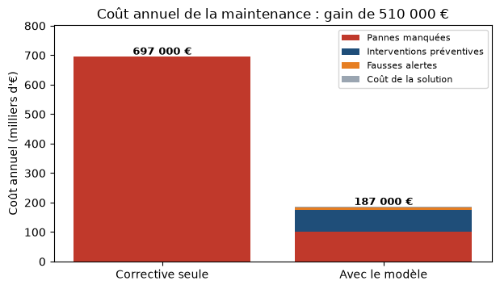
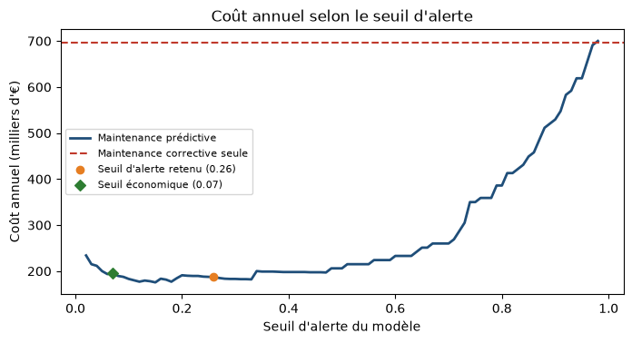

# PrédiMaint — Étude économique

*Générée automatiquement par `src/economie.py`. Toutes les valeurs de coût sont des **hypothèses**, modifiables dans le code et dans l'application.*

## 1. Question posée

Combien l'usine économise-t-elle en intervenant **avant** la panne, grâce au modèle, plutôt que de réparer **après** la panne (maintenance corrective) ?

## 2. Hypothèses de coût

| Hypothèse | Valeur |
|---|---|
| Durée d'arrêt après une panne imprévue | 4 h |
| Production perdue par heure d'arrêt | 350 € |
| Réparation après panne (main-d'œuvre et pièces) | 500 € |
| Pièce en cours rebutée | 150 € |
| **Coût total d'une panne imprévue** | **2 050 €** |
| Intervention préventive planifiée | 250 € |
| Fausse alerte (inspection inutile) | 100 € |
| Coût annuel de la solution | 3 000 € |
| Opérations d'usinage surveillées par an | 10 000 |

Le volume de 10 000 opérations par an correspond à la taille du jeu de données. Les résultats du modèle sur le jeu de test (2 000 relevés jamais vus) sont multipliés par 5 pour représenter une année.

## 3. Résultat au seuil d'alerte retenu (0,26)

|  | Corrective seule | Avec le modèle |
|---|---|---|
| Pannes sur l'année | 340 | 340 |
| Pannes évitées grâce à une intervention préventive | 0 | 290 |
| Pannes manquées (payées au prix fort) | 340 | 50 |
| Fausses alertes | 0 | 90 |
| **Coût annuel** | **697 000 €** | **187 000 €** |

**Gain annuel : 510 000 €**, soit une **réduction de 73 %** du coût de la maintenance. Pour 1 € dépensé dans la solution, l'usine économise environ **170 €**.

Détail du coût avec le modèle :

- les **pannes manquées** pèsent le plus : 102 500 € ;
- les **interventions préventives** coûtent 72 500 € ;
- les **fausses alertes** coûtent 9 000 € ;
- la **solution** elle-même coûte 3 000 € par an.

## 4. Quel seuil d'alerte choisir ? (fonction F12)

Baisser le seuil fait partir plus d'alertes : on manque moins de pannes, mais on multiplie les fausses alertes. Le **seuil économique** est celui qui minimise le coût total. Il est choisi sur les données d'entraînement (validation croisée), puis vérifié sur le test.

| Seuil | Pannes évitées / an | Fausses alertes / an | Coût annuel (test) |
|---|---|---|---|
| Seuil d'alerte retenu à l'étape 3 (0,26) | 290 | 90 | 187 000 € |
| Seuil économique choisi sur l'entraînement (0,07) | 310 | 535 | 195 500 € |

La courbe est **très plate** entre 0,08 et 0,33 : sur toute cette plage, le coût reste à moins de 10 % de son minimum. Le choix exact du seuil a donc peu d'effet sur le coût. Sur le test, le seuil économique coûte même 8 500 € de plus que le seuil retenu : il avait été optimisé sur les données d'entraînement, et ce petit écart relève du hasard de l'échantillon.

En pratique, le seuil de **0,26** est le meilleur compromis : presque aussi économique, il limite les fausses alertes (90 par an au lieu de 535). C'est important sur le terrain : trop de fausses alertes, et les techniciens finissent par ne plus y croire.

## 5. Sensibilité au coût d'une panne

Que se passe-t-il si une panne coûte beaucoup moins (ou beaucoup plus) cher que prévu ? Les autres hypothèses restent inchangées.

| Coût d'une panne | Coût corrective | Coût prédictive | Gain annuel | Réduction |
|---|---|---|---|---|
| 500 € | 170 000 € | 109 500 € | 60 500 € | 36 % |
| 1 000 € | 340 000 € | 134 500 € | 205 500 € | 60 % |
| 2 050 € | 697 000 € | 187 000 € | 510 000 € | 73 % |
| 3 000 € | 1 020 000 € | 234 500 € | 785 500 € | 77 % |
| 5 000 € | 1 700 000 € | 334 500 € | 1 365 500 € | 80 % |

La solution reste rentable dès qu'une panne coûte plus de **300 €** environ. La conclusion est donc solide : même avec des hypothèses prudentes, la maintenance prédictive est nettement gagnante.

## 6. Limites

- Les coûts sont des **ordres de grandeur** : une usine réelle les remplacerait par ses propres chiffres (taux horaire, coût des pièces, valeur de la production).
- Le taux de panne du jeu de données (3,4 %) est élevé ; le gain dépend directement du nombre de pannes réelles.
- Les performances du modèle viennent de **données synthétiques** : sur une vraie usine, il manquerait sans doute plus de pannes, ce qui réduirait le gain.
