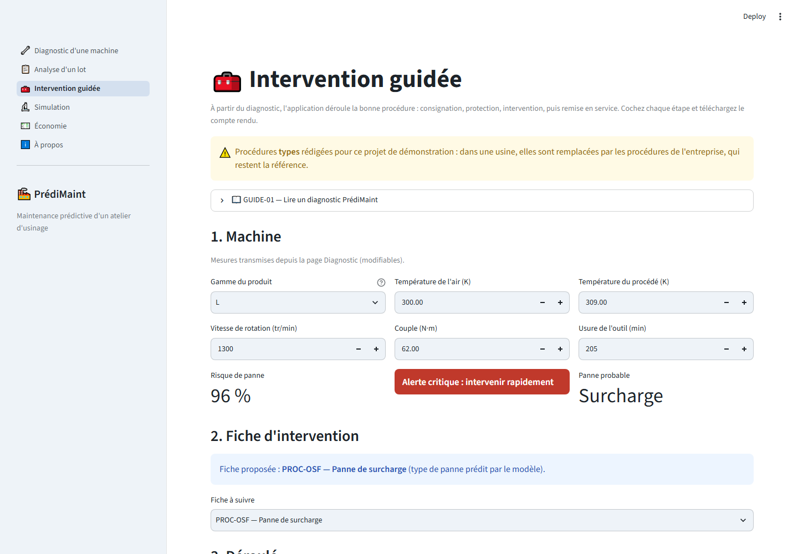
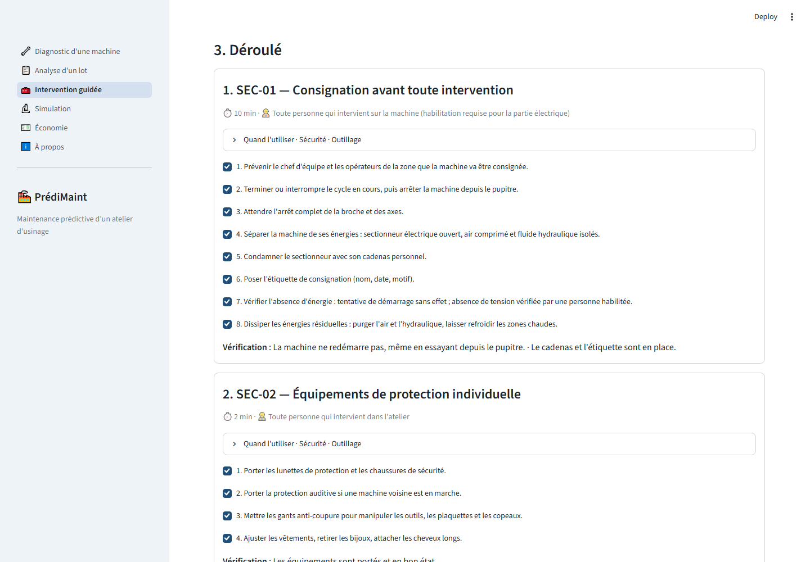

# PrédiMaint — Phase 2 : intervention guidée

*Première partie de la phase 2 : guider le technicien de l'alerte jusqu'à la remise en service, sans modèle de langage, donc sans coût d'utilisation.*

## 1. Pourquoi cette étape

La phase 1 annonce la panne et recommande une action en une phrase. Sur le terrain, le technicien doit savoir **comment** intervenir en sécurité, **avec quoi**, et **comment vérifier** le résultat.

Le cahier des charges de la phase 2 prévoit à terme un assistant IA conversationnel. Celui-ci demande une API payante : il a été reporté. Cette première partie apporte l'essentiel, gratuitement et sans aucun risque d'erreur inventée :

- les **procédures** sont rédigées une fois pour toutes ;
- l'application choisit **la bonne fiche** à partir du diagnostic et la déroule étape par étape.

Les fiches serviront aussi de base documentaire au futur assistant IA.

## 2. La base de procédures

Neuf fiches au format Markdown, dans `data/procedures/`. Elles sont lisibles par un humain et par le programme.

| Code | Fiche | Étapes |
|---|---|---|
| SEC-01 | Consignation avant toute intervention | 8 |
| SEC-02 | Équipements de protection individuelle | 4 |
| PROC-OSF | Panne de surcharge | 8 |
| PROC-HDF | Panne de dissipation de chaleur | 8 |
| PROC-PWF | Panne de puissance | 6 |
| PROC-TWF | Changement préventif de l'outil | 6 |
| PROC-RNF | Inspection générale de la machine | 6 |
| CTRL-01 | Contrôles après intervention et remise en service | 7 |
| GUIDE-01 | Lire un diagnostic PrédiMaint | 5 |

Chaque fiche comporte : la durée estimée, l'intervenant, « quand l'utiliser », la sécurité, l'outillage et les pièces, les étapes et la vérification.

**Honnêteté** : ce sont des procédures **types**, rédigées pour le projet à partir des bonnes pratiques de maintenance (consignation, protections, entretien de l'arrosage, changement d'outil…). Dans une usine, elles seraient remplacées par les procédures de l'entreprise. L'application l'affiche en permanence.

**Ajouter ou modifier une fiche** ne demande aucune programmation : il suffit d'éditer le fichier Markdown. Le programme vérifie sa structure (titre, sections obligatoires), et un test automatique contrôle toutes les fiches.

## 3. Choix de la fiche

| Situation | Fiche proposée |
|---|---|
| Alerte du modèle (risque ≥ 26 %) | Fiche du type de panne prédit : PROC-OSF, PROC-HDF, PROC-PWF ou PROC-TWF |
| Pas d'alerte, mais usure de l'outil ≥ 200 min | PROC-TWF (changement préventif, règle des 200 minutes) |
| Pas d'alerte, outil hors de la zone d'usure | Aucune intervention ; une inspection (PROC-RNF) reste possible |

Le technicien peut toujours choisir une autre fiche.

## 4. La page « Intervention guidée »

On y accède de deux façons :
- par le bouton **« Lancer l'intervention guidée »** de la page Diagnostic, qui transmet les mesures de la machine ;
- directement depuis le menu.

1. **Machine** : les mesures, le risque, le niveau d'alerte et la panne probable.
2. **Fiche d'intervention** : la fiche proposée et la raison de ce choix.
3. **Déroulé** : toujours dans le même ordre :

   **consignation (SEC-01) → protections (SEC-02) → intervention → remise en service (CTRL-01)**

   Chaque étape se coche. Une barre d'avancement indique où l'on en est.
4. **Compte rendu** : le nom du technicien et les observations, puis le **téléchargement d'un compte rendu** (date, machine, diagnostic, étapes réalisées ou non, observations), prêt à archiver ou à saisir dans la GMAO.

**Règle de sécurité intégrée** : les étapes d'intervention ne s'affichent **qu'une fois la consignation entièrement validée**. On ne peut pas « sauter » la mise en sécurité.

## 5. Tests

| Test | Résultat |
|---|---|
| Les 9 fiches sont lues et complètes (sections, durée, intervenant) | ✅ |
| Chaque type de panne a sa fiche | ✅ |
| La consignation vient toujours en premier, et chaque fiche d'intervention y renvoie | ✅ |
| Choix de la fiche : surcharge, chaleur, zone d'usure sans alerte, machine normale | ✅ |
| Une fiche mal formée est refusée avec un message clair | ✅ |
| Le compte rendu contient la date, le technicien, le diagnostic, l'avancement et les observations | ✅ |
| Parcours complet dans le navigateur : diagnostic « surcharge », bouton, fiche PROC-OSF, verrou de consignation, 27 étapes, compte rendu téléchargé | ✅ |

Le projet compte désormais **35 tests automatiques**, tous réussis.

## 6. Suite possible

Ajouter l'**assistant IA** prévu dans le cahier des charges de la phase 2. Il répondrait aux questions du technicien en s'appuyant sur ces mêmes fiches et sur le modèle de diagnostic, avec une API gratuite ou payante, selon le choix qui sera fait.
