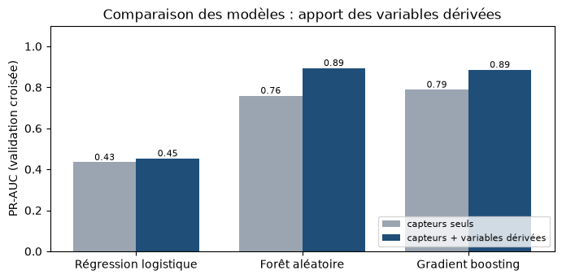
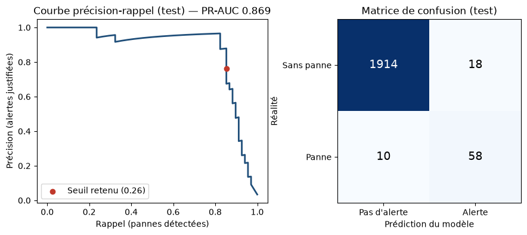
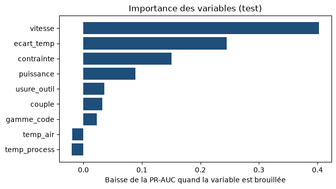

# PrédiMaint — Rapport de performances du modèle

*Généré automatiquement par `src/entrainer.py` le 2026-11-14 — graine aléatoire 42.*

## 1. Démarche

- Données : AI4I 2020 (10 000 relevés, 339 pannes). **80 %** pour l'entraînement (8000 relevés), **20 %** gardés pour le test final (2000 relevés, 68 pannes), séparation stratifiée.
- Comparaison de 3 algorithmes, **avec et sans** les variables dérivées, par validation croisée à 5 plis sur les données d'entraînement.
- Choix du modèle selon la **PR-AUC**, adaptée aux données déséquilibrées.
- Seuil d'alerte choisi sur la validation croisée : **0,258**. C'est le seuil qui maximise le F1 tout en détectant au moins 85 % des pannes.
- Test final réalisé **une seule fois**, sur des données jamais vues par le modèle.
- Entrées : gamme, 5 capteurs et 3 variables dérivées. Les colonnes TWF à RNF ne sont **jamais** utilisées en entrée.

## 2. Comparaison des modèles (validation croisée, seuil 0,5)

| Modèle | Variables | Rappel | Précision | F1 | PR-AUC |
|---|---|---|---|---|---|
| Régression logistique | capteurs seuls | 0.801 | 0.136 | 0.232 | 0.434 |
| Forêt aléatoire | capteurs seuls | 0.576 | 0.830 | 0.680 | 0.760 |
| Gradient boosting | capteurs seuls | 0.705 | 0.799 | 0.749 | 0.789 |
| Régression logistique | capteurs + variables dérivées | 0.845 | 0.162 | 0.272 | 0.453 |
| Forêt aléatoire | capteurs + variables dérivées | 0.808 | 0.948 | 0.873 | 0.894 |
| Gradient boosting | capteurs + variables dérivées | 0.823 | 0.970 | 0.890 | 0.886 |

**Modèle retenu : Forêt aléatoire, avec les variables dérivées.**

Les variables dérivées (écart de température, puissance, contrainte) améliorent nettement les modèles à base d'arbres : PR-AUC de 0,76 à 0,89 (forêt aléatoire) et 0,79 à 0,89 (gradient boosting). La régression logistique reste faible (0,43 puis 0,45) : les pannes dépendent de seuils, parfois des deux côtés (puissance trop faible **ou** trop forte), ce qu'un modèle linéaire ne sait pas représenter. La forêt aléatoire et le gradient boosting sont très proches ; le choix se fait sur la PR-AUC.

## 3. Résultats sur le jeu de test

| Indicateur | Cible | Résultat | Atteint |
|---|---|---|---|
| Rappel (pannes détectées) | ≥ 85 % | 85,3 % | ✅ |
| Précision (alertes justifiées) | ≥ 70 % | 76,3 % | ✅ |
| F1-score | ≥ 0,75 | 0,806 | ✅ |
| PR-AUC | À maximiser | 0,869 | — |

Au seuil retenu, sur 2000 relevés de test :

- **58 pannes détectées** sur 68 ;
- **10 pannes manquées** ;
- **18 fausses alertes** ;
- **1914 relevés normaux** correctement laissés sans alerte.

### Détection par type de panne

| Type de panne | Pannes dans le test | Détectées | Taux |
|---|---|---|---|
| Usure de l'outil | 10 | 2 | 20,0 % |
| Dissipation de chaleur | 29 | 29 | 100,0 % |
| Puissance | 13 | 13 | 100,0 % |
| Surcharge | 16 | 16 | 100,0 % |
| Sans type indiqué | 2 | 0 | 0,0 % |

Le jeu de test ne contient aucune panne aléatoire seule.

En excluant les pannes **imprévisibles par nature** (pannes aléatoires seules et pannes sans type indiqué), le modèle détecte **87,9 %** des pannes.

**Pannes d'usure de l'outil : seulement 2 sur 10 détectées.** Ces pannes se produisent à un moment tiré au hasard entre environ 200 et 250 minutes d'usure, et la plupart des outils qui atteignent cette zone ne cassent pas : les capteurs ne permettent pas de savoir *lequel* va casser. La bonne réponse est **préventive** : changer systématiquement l'outil avant 200 minutes d'usure. L'application signale donc la zone d'usure à risque, même quand le risque calculé reste sous le seuil d'alerte.

### Type de panne

Pour les pannes de type connu, le modèle « type de panne » désigne le bon type dans **93,9 %** des cas. C'est ce type qui détermine l'action de maintenance recommandée par l'application.

## 4. Importance des variables

L'importance est mesurée par permutation : on brouille une variable et on regarde de combien la performance baisse.

Les trois variables les plus utiles sont **vitesse, ecart_temp, contrainte**. C'est cohérent avec la physique des pannes : la vitesse intervient dans la dissipation de chaleur et dans la puissance, l'écart de température dans la dissipation de chaleur, et la contrainte dans la surcharge. Les températures prises isolément n'apportent presque rien : seul leur **écart** compte.

## 5. Limites

- **Données synthétiques** : les pannes de chaleur, de puissance et de surcharge suivent des règles exactes (étape 2). Les performances sont donc bien meilleures que ce qu'on obtiendrait sur une vraie usine.
- Les **pannes aléatoires** et les pannes **sans type** ne peuvent pas être anticipées par les capteurs.
- Les **pannes d'usure** surviennent à un moment tiré au hasard entre environ 200 et 250 minutes. Le modèle repère la zone de risque, pas l'instant exact.
- Sur une vraie usine, il faudrait réentraîner le modèle sur ses propres données et surveiller ses performances dans le temps.

## 6. Environnement

Python 3.15.0, scikit-learn 1.9.1, pandas 3.1.1, NumPy 2.5.4.
